# SPI Master in SystemVerilog (all 4 modes)
An SPI master that sends and receives one byte per transfer, supports all four SPI modes (CPOL/CPHA) and a configurable SCLK speed. It was verified with a self-checking testbench in every mode, checked against a peripheral using the wrong mode, and tested on a Spartan-7 FPGA with LEDs, a logic analyzer and a Python test suite that drives the SPI link from a PC.

<p align="center">
  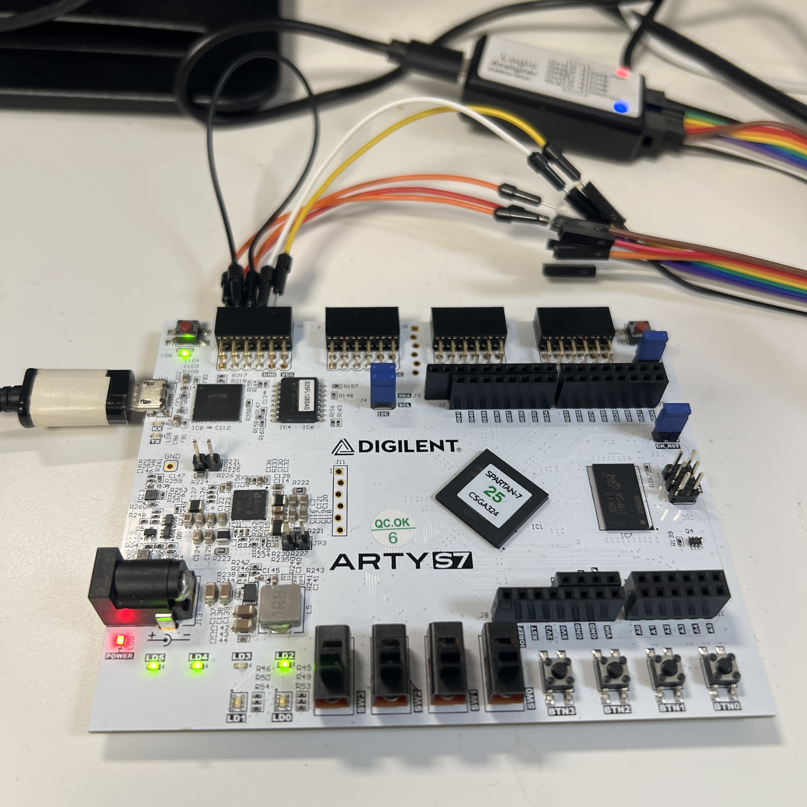
</p>

## Results at a glance

| Check | Result |
|---|---|
| Simulation, 4 modes + 3 SCLK speeds (6 runs) | **TEST PASSED**, 199 checks per run, 0 errors |
| Wrong mode (master mode 0, peripheral mode 1) | bytes received exactly as predicted (e.g. `3C` arrives as `1E`) |
| Timing (routed, 12 MHz, board self-test) | **met**, WNS 79.560 ns, WHS 0.142 ns |
| Resources (board self-test) | 40 LUTs, 85 flip-flops, 0 block RAM, 12 I/O |
| Board self-test, MOSI wired to MISO | error LED **off**; turns **on** when the wire is removed |
| PC test suite (pytest over UART) | **262 passed** (256 single bytes, a 256-byte burst, 5 random bursts of 1,000 bytes) |
| Same suite with the wire removed | **261 failed**, 1 passed: the tests detect a broken link |

## What is SPI?

SPI connects a master (here, the FPGA) to a peripheral (a sensor, a flash memory, a display)
with four wires:

| Wire | Direction | Meaning |
|---|---|---|
| `SCLK` | master -> peripheral | clock, generated by the master |
| `MOSI` | master -> peripheral | data out of the master |
| `MISO` | peripheral -> master | data out of the peripheral |
| `CS_n` | master -> peripheral | chip select, low during a transfer |

Every transfer is a **swap**: on each clock pulse, one bit goes out on MOSI and one bit comes in on MISO, most significant bit first. After 8 pulses, the master has sent its byte and received the peripheral's byte.

### The four modes

Peripherals don't all use the same clock convention. Two settings describe it:

- **CPOL**: the level of SCLK when idle (0 = low, 1 = high).
- **CPHA**: which edge of each clock pulse reads the data.
  - CPHA = 0: bit 7 is on the wire as soon as CS_n falls, the **first** edge reads, the second edge changes the data.
  - CPHA = 1: the **first** edge changes the data, the **second** edge reads.

| Mode | CPOL | CPHA | SCLK idle | Data read on | Data changed on |
|---|---|---|---|---|---|
| 0 | 0 | 0 | low | rising edge | falling edge |
| 1 | 0 | 1 | low | falling edge | rising edge |
| 2 | 1 | 0 | high | falling edge | rising edge |
| 3 | 1 | 1 | high | rising edge | falling edge |

The master and the peripheral must use the same mode, otherwise bytes arrive shifted
(see [Wrong mode](#wrong-mode-test-simulationspi_wrong_mode_tbsv)).

## Design (`design/spi_master.sv`)

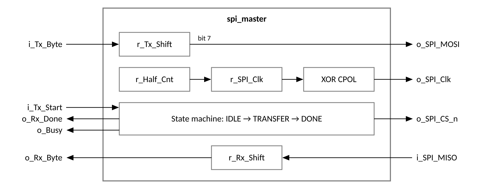

- **State machine:** `IDLE` waits for `i_Tx_Start` and pulls CS_n low; `TRANSFER` runs the
  8 clock pulses; `DONE` raises CS_n, outputs the received byte and pulses `o_Rx_Done` for
  one clock.
- **SCLK generator:** `r_Half_Cnt` counts `CLKS_PER_HALF_BIT` system clocks, then
  `r_SPI_Clk` flips. One SCLK period is `2 × CLKS_PER_HALF_BIT` system clocks.
- **All four modes with one internal clock:** inside the design, `r_SPI_Clk` always idles low,
  so the logic only deals with a "first edge" and a "second edge" of each pulse.
  - **CPOL** is applied at the output only: `o_SPI_Clk = r_SPI_Clk ^ CPOL` (XOR with 1 inverts
    the clock, XOR with 0 leaves it unchanged).
  - **CPHA** selects which edge reads MISO and which edge shifts the next bit onto MOSI. With
    CPHA = 1 the very first edge doesn't shift, because bit 7 is already on MOSI.
- **CS_n** goes high in `DONE`, one system clock **after** the last SCLK edge, so the
  peripheral always reads bit 0 before CS_n rises (see [What I got wrong](#what-i-got-wrong)).
- A start request while `o_Busy` is high is ignored.

### Interface

| Port | Direction | Meaning |
|---|---|---|
| `i_Clk`, `i_Rst_n` | in | system clock, active-low asynchronous reset |
| `i_Tx_Byte`, `i_Tx_Start` | in | byte to send, one-clock start pulse |
| `o_Busy` | out | high from start until the transfer is finished |
| `o_Rx_Byte`, `o_Rx_Done` | out | byte received, one-clock pulse when it is valid |
| `o_SPI_Clk`, `o_SPI_MOSI`, `o_SPI_CS_n` | out | SPI lines to the peripheral |
| `i_SPI_MISO` | in | SPI line from the peripheral |

| Parameter | Default | Meaning |
|---|---|---|
| `CLKS_PER_HALF_BIT` | 2 | SCLK = system clock / (2 × `CLKS_PER_HALF_BIT`); minimum 2 |
| `CPOL` | 0 | SCLK idle level |
| `CPHA` | 0 | read edge (see the table above) |

The mode is chosen with parameters, so it is fixed when the design is built. 

## Verification (`simulation/spi_master_tb.sv`)

- A **peripheral model** sits on the other end of the SPI wires. It follows the same CPOL/CPHA  as the master, receives the master's byte and sends its own byte back, so **every transfer checks both directions**.
- Every transfer also checks: exactly 8 SCLK pulses, SCLK and CS_n back at their idle levels,  `o_Busy` low at the end, and `o_Rx_Done` high for exactly one clock.
- A watchdog stops the simulation if a transfer never finishes.

| Test | What it checks |
|---|---|
| 1 | after reset: SCLK at its idle level, CS_n high, not busy |
| 2 | `A5` / `3C`: both directions in one transfer |
| 3 | `00` / `FF` and `FF` / `00`: a data line held at 0 or 1 for the whole byte |
| 4 | `80` / `01` and `01` / `80`: most significant bit first |
| 5 | 8 SCLK pulses per transfer (checked in every transfer) |
| 6 | `o_Busy` and `o_Rx_Done` behaviour (checked in every transfer) |
| 7 | a start request while busy is ignored (no second transfer, data unchanged) |
| 8 | two transfers back to back |
| 9 | 20 random byte pairs |
| 10 | SCLK period measured against `2 × CLKS_PER_HALF_BIT × 83.333 ns` |

| Run | CLKS_PER_HALF_BIT | SCLK period | Mode | Result |
|---|---|---|---|---|
| `half2` | 2 | 333 ns | 0 | 199 / 199 PASS |
| `half3` | 3 | 500 ns | 0 | 199 / 199 PASS |
| `half5` | 5 | 833 ns | 0 | 199 / 199 PASS |
| `mode1` | 2 | 333 ns | 1 | 199 / 199 PASS |
| `mode2` | 2 | 333 ns | 2 | 199 / 199 PASS |
| `mode3` | 2 | 333 ns | 3 | 199 / 199 PASS |

Console logs: `results/spi_master_tb_console_*.txt`.

**Mode 0, `A5` / `3C`:** the master sends `A5` on MOSI while the peripheral sends `3C` on MISO.
`r_P_Rx` (the peripheral's receive register) fills up one bit per SCLK pulse until it holds
`A5`, and `w_Rx_Byte` shows `3C` when `w_Rx_Done` pulses.

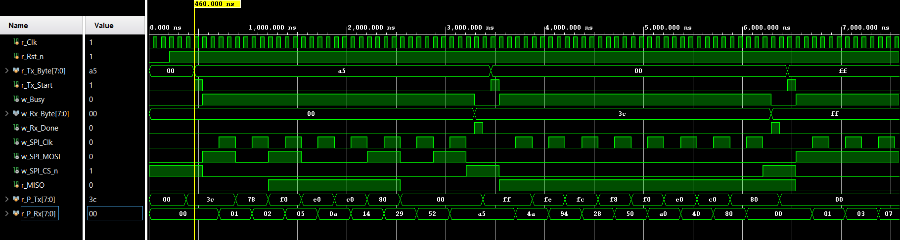

**Start while busy:** a second start pulse arrives in the middle of the `C3` transfer and is
ignored; the transfer finishes normally.

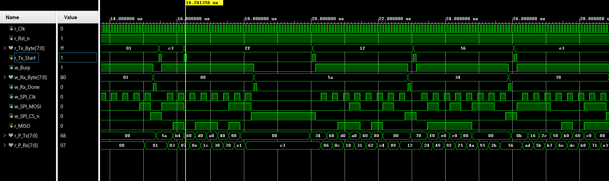

**Mode 3:** SCLK idles high (CPOL = 1). `r_P_Rx` again builds up `A5` one bit at a time,
reaching `A5` before CS_n rises.

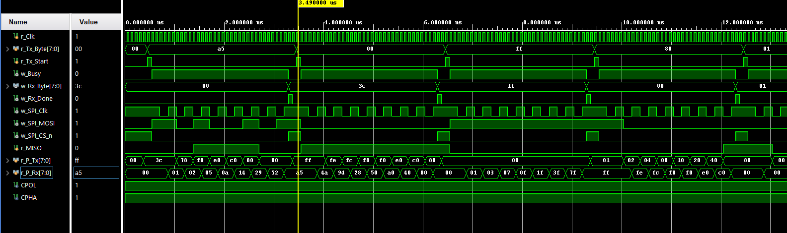

## Wrong-mode test (`simulation/spi_wrong_mode_tb.sv`)

A second testbench answers the question: **what does the master receive if the peripheral uses
the wrong mode?** The master stays in mode 0. The peripheral model first uses mode 0, then
mode 1. Before running it, I predicted the bytes the master should receive, and the test
checks those predictions.

In mode 1, the peripheral changes MISO on the rising edge, which is exactly the edge the
mode-0 master reads on. The master therefore reads every bit one edge too early: it gets the
last bit left on MISO from the previous byte, followed by bits 7 to 1. The byte arrives
**shifted right by one**.

| Peripheral sends | Master receives | Why |
|---|---|---|
| `3C` (0011 1100) | `1E` (0001 1110) | shifted right, MISO was 0 before the first edge |
| `01` (0000 0001) | `00` (0000 0000) | bit 0 is lost |
| `80` (1000 0000) | `C0` (1100 0000) | shifted right, the previous byte (`01`) left MISO at 1 |

All predictions matched: `results/spi_wrong_mode_console.txt`.

The MOSI and MISO wires in this testbench have a **5 ns delay**, as on a real board. Without
it, a side that reads a wire at the same simulation instant the other side changes it creates a
**race**: the result depends on the order in which the simulator processes the two events,
which the language doesn't define. Vivado's simulator happened to give the same bytes with
0 ns delay (`results/spi_wrong_mode_console_nodelay.txt`), but the delay makes the result
independent of the simulator.

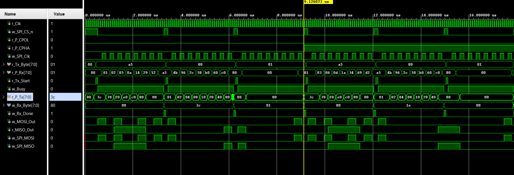

From 9.1 µs the peripheral switches to mode 1 (`r_P_CPHA` goes high), and `w_Rx_Byte` shows
`1E` instead of `3C`.

## Hardware tests

Both tests use the Arty S7-25 (12 MHz clock, SCLK = 1 MHz with `CLKS_PER_HALF_BIT = 6`) in
mode 0, with a jumper wire from MOSI to MISO on Pmod JA, so every byte sent should come back
unchanged.

| Pmod JA pin | FPGA pin | Signal |
|---|---|---|
| JA1 | L17 | CS_n |
| JA2 | L18 | MOSI (wired to JA3) |
| JA3 | M14 | MISO, with an internal pull-down |
| JA4 | N14 | SCLK |
| JA7 | M16 | copy of MISO (logic analyzer test point) |
| JA8 | M17 | copy of MOSI (logic analyzer test point) |

MISO has a **pull-down** (`PULLDOWN TRUE` in the constraints), so with the wire removed it
reads a steady 0 instead of a floating value. This makes the "wire removed" result
predictable: every byte comes back as `00`.

### 1. Board self-test (`design/spi_top.sv`)

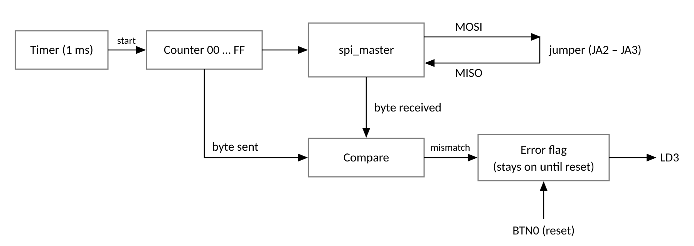

- Sends `00, 01, 02 … FF, 00 …`, one byte every millisecond, and compares each received byte
  with the byte sent.
- Any mismatch sets an error flag that **stays on** until BTN0 (reset) is pressed, so even a
  short fault is not missed.

| LED | Meaning | Result |
|---|---|---|
| LD2 | heartbeat | blinking |
| LD3 | error (stays on) | **off** with the jumper in place, **on** when the jumper is removed |
| LD4, LD5 | top two bits of the byte being sent | blinking (bytes are flowing) |

<p align="center">
  
  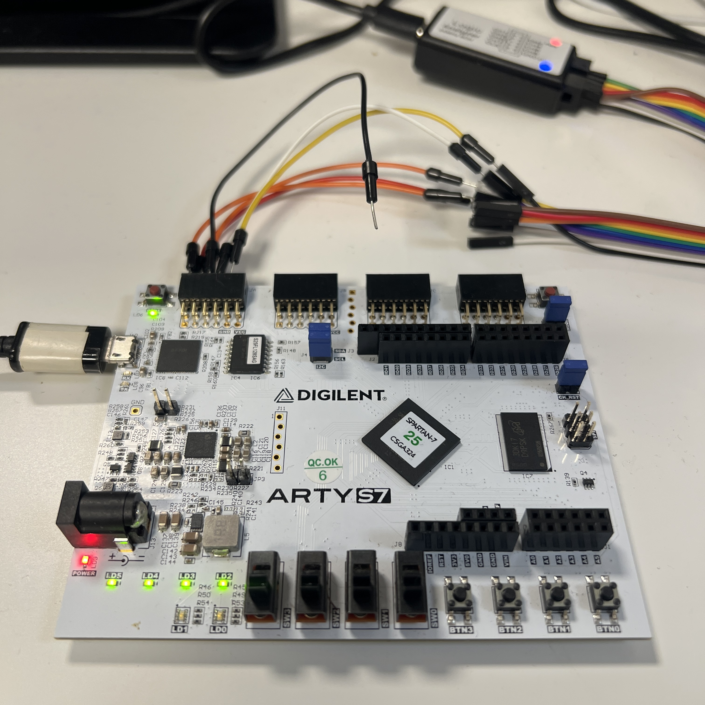
</p>

Left: jumper in place, error LED (LD3) off. Right: jumper removed, error LED on.

<!-- video: error LED clearing when BTN0 is pressed -->

**Logic analyzer (PulseView, SPI decoder):** one transfer of `A3`: CS_n low, 8 clock pulses,
and the same byte on MOSI and MISO.

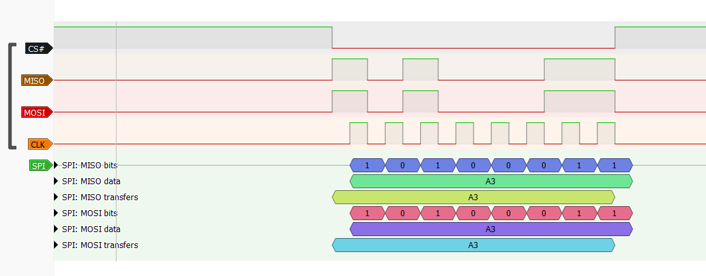

Several transfers, one every 1 ms (the cursors measure 1.00013 ms between two transfers):

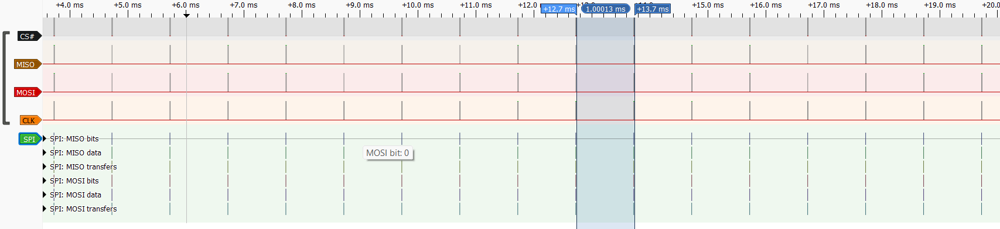

| Board self-test (routed) | |
|---|---|
| LUTs / flip-flops / block RAM / I/O | 40 / 85 / 0 / 12 |
| WNS / WHS (12 MHz) | 79.560 ns / 0.142 ns |

Reports: `results/spi_top_timing_summary.txt`, `results/spi_top_utilization.txt`.

### 2. PC-driven test with pytest (`design/spi_uart_top.sv`, `validation_tests/test_spi_loopback.py`)

The board self-test only sends a counting pattern. To send **any** byte, in any order, at
full speed, the PC drives the SPI link through the board's USB-UART:

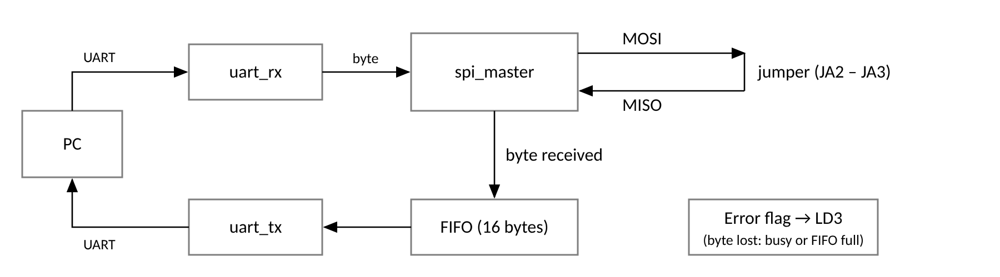

- Each byte received from the PC (115,200 baud) starts one SPI transfer.
- The byte read back on MISO goes into a **FIFO**, then back to the PC through the UART
  transmitter.
- **Why the FIFO:** the UART transmitter takes slightly longer to send a byte (start bit,
  8 data bits, stop bit, plus a couple of clocks between bytes) than the PC takes to deliver
  the next one, so in a long back-to-back burst the bytes waiting to be sent slowly pile up.
  The 16-byte FIFO absorbs this difference for thousands of bytes, far more than the longest
  burst in the tests (1,000 bytes).
- An error flag (LD3) turns on if a byte arrives while the SPI master is still busy, or if the
  FIFO is full.
- The UART receiver, transmitter and FIFO are reused from my
  [uart-rtl-validation-spartan7](https://github.com/micahpinto/uart-rtl-validation-spartan7)
  project, where they were already tested on this board.

**Test suite** (pytest + pyserial):

| Test | Count | What it checks |
|---|---|---|
| `test_every_byte` | 256 | every value `00` to `FF`, one at a time |
| `test_burst_all_values` | 1 | all 256 values sent back to back |
| `test_random_burst` | 5 | 1,000 random bytes back to back, seeds 0 to 4 (repeatable) |
| `test_jumper_out_reads_zero` | 1 | runs only with the jumper removed: every byte must come back as `00` |

The random bursts use fixed seeds, so a failing burst can be re-run with exactly the same
bytes. Each burst checks the **number** of bytes first (a missing or extra byte means data was
lost) and then the **values**.

| Run | Jumper | Result | File |
|---|---|---|---|
| Normal | in place | **262 passed**, 1 skipped | `results/pytest_loopback.txt` |
| After adding the 4 modes (board in mode 0) | in place | **262 passed**, 1 skipped | `results/pytest_loopback_4modes.txt` |
| Jumper-removed test (`JUMPER_OUT=1`) | removed | **1 passed**, 262 skipped | `results/pytest_jumper_out.txt` |
| Normal suite with the jumper removed | removed | **261 failed**, 1 passed | `results/pytest_fail_no_jumper.txt` |

The last run proves the tests can fail: with the wire removed, every byte comes back as `00`
(the pull-down). The one test that still passes is `test_every_byte[0]`, because the byte it
sends is `00`.

## What I got wrong

- **CS_n raised too early (modes 1 and 3).** My first version raised CS_n on the last SCLK edge. In mode 0 that worked, but when I added the other modes, the testbench failed in  modes 1 and 3: the peripheral received `52` instead of `A5`. In those modes the last edge is a **read** edge, so CS_n went high at the same moment the peripheral should have read bit 0, and the byte came out shifted. **Fix:** raise CS_n in the `DONE` state, one system clock after the last edge. All four modes then passed.

## Repository layout

```
design/            spi_master.sv            SPI master, all 4 modes
                   spi_top.sv               board self-test (counter, checker, LEDs)
                   spi_uart_top.sv          PC-driven test: UART -> SPI -> FIFO -> UART
                   uart_rx.v, uart_tx.v, fifo.v   reused UART blocks and FIFO
simulation/        spi_master_tb.sv         self-checking testbench, all modes
                   spi_wrong_mode_tb.sv     master and peripheral in different modes
constraints/       spi_top.xdc, spi_uart_top.xdc   Arty S7-25 pins
validation_tests/  test_spi_loopback.py     pytest suite over the UART
results/           console logs, waveforms, pytest results, timing and utilization
                   reports, logic analyzer captures, board photos
```

## How to reproduce

1. **Simulation:** Vivado RTL project, part `xc7s25csga324-1`. Add `design/spi_master.sv` and
   `simulation/spi_master_tb.sv`, run Behavioral Simulation, then **Run All**. To test another
   mode or speed, change `CPOL`, `CPHA` or `CLKS_PER_HALF_BIT` at the top of the testbench.
   The wrong-mode test works the same way with `simulation/spi_wrong_mode_tb.sv`.
2. **Board self-test:** add `design/spi_master.sv`, `design/spi_top.sv` and
   `constraints/spi_top.xdc`, generate the bitstream and program the board. Wire JA2 to JA3.
3. **PC test:** build `design/spi_uart_top.sv` (with `spi_master.sv`, `uart_rx.v`, `uart_tx.v`,
   `fifo.v`) and `constraints/spi_uart_top.xdc`, program the board, then in Command Prompt:
   ```
   pip install pytest pyserial
   cd validation_tests
   pytest test_spi_loopback.py -v
   ```
   The serial port defaults to `COM4`; set `UART_PORT` to change it. For the jumper-removed
   test: remove the jumper, `set JUMPER_OUT=1`, and run pytest again.

